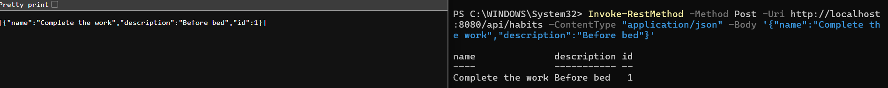
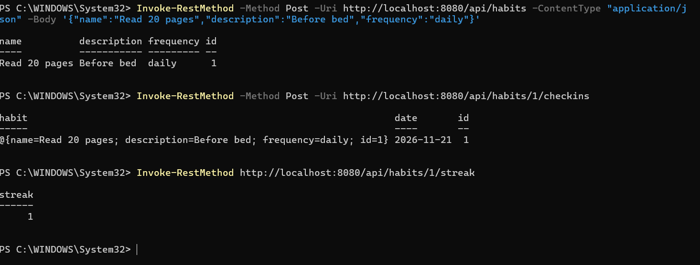
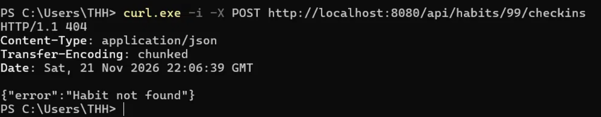

# - HabitPattern -
A REST API used for tracking tasks daily, with features such as streaks built with spring boot and H2 database.

## - Tech Stack - 

Spring boot (Web, Data JPA, Validation)
H2 Database (RAM)
Maven

## How to run 
1. Clone repository 
2. Run `.\mvnw spring-boot:run`
3. visit API location http://localhost:8080

The database runs on ram, through H2 database, therefore it resets everytime the program is ran again.

## Endpoints 
`/api/habits` - List all habits - GET
`/api/habits` - Create a new habit - POST
`/api/habits/{id}/checkins` - Log a check-in for today - POST
`/api/habits/{id}/streak` - Get the current streak for a habit - GET

## Design Notes
- A habit can only be checked in once a day, further attempts result in a return of 409
- Streaks are calculated by stopping at the first gap from walking backwards through check-in dates from the current day

## Screenshots

Creating a habit

**Streak result**

**Habit not found error**

## Notes
Built in 2 days as a learning project 
Made By Tameem Husayn